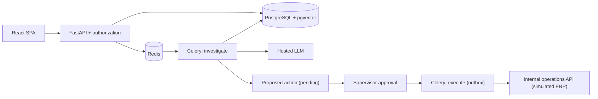

# OpsPilot

**A multi-tenant AI operations agent that investigates delayed orders with evidence-backed findings — and never writes anything without a supervisor's approval.**


An analyst asks *"Why is order SO-1042 delayed, and what should we do?"*. OpsPilot runs
a bounded agent that reads the order, its shipments and carrier events, retrieves the
operating policies in force, and returns typed findings — each marked as fact or
inference and linked to the records that support it. It may propose one follow-up
task; a supervisor approves the exact payload, and a durable worker creates it in the
(simulated) ERP exactly once.

> **Synthetic data, simulated ERP.** All operational data is generated, and the
> "internal operations API" the agent writes to is part of this repository. Both are
> labelled as such in the product.

---

## Contents

- [Features](#features)
- [Architecture](#architecture)
- [Tech stack](#tech-stack)
- [Getting started](#getting-started)
- [Usage](#usage)
- [Configuration](#configuration)
- [Testing and evaluation](#testing-and-evaluation)
- [Deployment](#deployment)
- [Project structure](#project-structure)
- [Documentation](#documentation)
- [Project status](#project-status)

## Features

| | |
| --- | --- |
| **Multi-tenancy** | `organization_id` is derived server-side from the verified membership, enforced in every query *and* by composite foreign keys. Order numbers collide across organizations on purpose, so a missing filter fails a test instead of leaking. A cross-tenant read is a 404, never a 403. |
| **Bounded autonomy** | At most 3 model calls, 6 tool calls and 90 seconds per run, retries included. Three typed, allowlisted read tools — no SQL, no URLs, no write tool. Hitting a bound returns a useful incomplete answer, not an error. |
| **Grounding** | Every factual claim carries an evidence id, validated in code against exactly what that run was shown. Unsupported citations are stripped from the display and counted for measurement. |
| **Human control** | Proposals are immutable and bound to a payload hash, the source record's version and a 24-hour expiry. Approval must echo the hash the screen displayed; a changed order invalidates it. |
| **Durability** | Transactional outbox, at-least-once delivery, deterministic idempotency keys, and reconciliation by key when an outcome is unknown — never a blind retry of an uncertain write. |
| **Policy retrieval** | Markdown/text policy upload with versioning and effective dates, heading-aware chunking, and exact pgvector search filtered by tenant and effective date *before* ranking. |
| **Observability** | Per-run tokens, cost estimate, latency, retries and tool outcomes; a metrics dashboard and run history with user feedback. |
| **Evaluation** | 80 frozen cases (40 development / 40 held out) covering tenancy, approvals, crash recovery, injection and missing evidence, run against a deterministic baseline in an isolated database. |

## Architecture



The investigation worker never waits for a human: it ends at *awaiting approval*.
Approval is a separate request that writes an outbox event in the same transaction;
the execute worker claims it durably before calling the ERP and looks the idempotency
key up before every possible write.

See [ARCHITECTURE.md](docs/ARCHITECTURE.md), [DATA-MODEL.md](docs/DATA-MODEL.md),
[STATE-MACHINES.md](docs/STATE-MACHINES.md), [SECURITY.md](docs/SECURITY.md) and the
[architecture decision records](docs/adr/README.md).

## Tech stack

| Layer | Technology |
| --- | --- |
| Frontend | React 18, TypeScript, Vite, TanStack Query; types generated from the OpenAPI schema |
| API | FastAPI, Pydantic v2, SQLAlchemy 2 (sync), Alembic |
| Data | PostgreSQL 16 with pgvector, Redis 7 |
| Workers | Celery (investigate, execute/outbox, beat) |
| Models | Provider adapter: OpenRouter (free-only routing by default), OpenAI, Anthropic, and a deterministic offline provider |
| Tooling | uv, ruff, mypy, pytest, pnpm |
| Deployment | Docker Compose, Caddy (automatic HTTPS) |

No agent framework: the loop in [`agent/orchestrator.py`](apps/api/src/opspilot/agent/orchestrator.py)
is explicit so that bounds, tenancy and evidence handling stay reviewable.

## Getting started

### Prerequisites

- [Docker Desktop](https://www.docker.com/products/docker-desktop/) (PostgreSQL and Redis)
- [uv](https://docs.astral.sh/uv/) (Python 3.12 is installed by uv)
- Node.js 22 and [pnpm](https://pnpm.io/) 9

### Installation

```bash
git clone <repository-url> opspilot && cd opspilot
cp .env.example .env               # runs keyless: scripted model, synthetic data
pnpm install
cd apps/api && uv sync --extra dev && cd ../..
```

### Run

```bash
pnpm stack
```

One command starts PostgreSQL and Redis, applies migrations, seeds the synthetic
dataset if the database is empty, and runs the API, both workers, the scheduler and
the web app. Ctrl+C stops everything.

```
[stack] OpsPilot is running    http://127.0.0.1:5173
[stack] API                    http://127.0.0.1:8000/docs
```

Logs are written to `.data/dev/<process>.log`. To stop the database containers
afterwards (data is kept): `docker compose stop postgres redis`.

## Usage

Open http://127.0.0.1:5173 and sign in with one click as a seeded user:

| User | Role | Organization |
| --- | --- | --- |
| `ana.analyst@northwind.example.com` | analyst | Northwind Supply |
| `sam.supervisor@northwind.example.com` | supervisor | Northwind Supply |
| `hal.analyst@harbor.example.com` | analyst | Harbor Wholesale |
| `hana.supervisor@harbor.example.com` | supervisor | Harbor Wholesale |

A typical walkthrough:

1. **Inbox** — as Ana, filter overdue or carrier-flagged orders and press
   *Investigate* on one (or open the order to see its lines, shipments and events).
2. **Case** — read the summary, the findings with their evidence, the cited policy
   passages, what could not be established, the tool activity and the proposed task.
3. **Approvals** — sign in as Sam and approve the exact payload. Within seconds the
   worker creates the task; the case and the order show it.
4. **Knowledge** — as a supervisor, upload `data/policies/delayed-shipments.md`; new
   investigations cite its passages.
5. **Investigations** and **Metrics** — run history, failures by reason, cost and
   latency, approval and execution outcomes.
6. Sign in as a Harbor user: none of Northwind's data is visible.

## Configuration

All settings are environment variables read once by
[`core/config.py`](apps/api/src/opspilot/core/config.py); see
[`.env.example`](.env.example) for the full list. The most important:

| Variable | In `.env.example` | Purpose |
| --- | --- | --- |
| `LLM_PROVIDER` | `fake` | `fake`, `openrouter`, `openai` or `anthropic` |
| `LLM_MODEL` | `gpt-4.1-mini` | Model id for the selected provider (e.g. `openrouter/free`) |
| `EMBEDDING_PROVIDER` | `fake` | `fake` (word hashing), `openrouter` (Liquid) or `openai` |
| `OPERATIONS_AS_OF` | `2026-09-12` | Business date for "overdue" and "effective"; blank means today |
| `RUN_MAX_TURNS` / `RUN_MAX_TOOL_CALLS` / `RUN_DEADLINE_SECONDS` | `3` / `6` / `90` | Hard run bounds |
| `BUDGET_DAILY_USD` / `BUDGET_MONTHLY_USD` | `2` / `15` | Spend caps, enforced before every model call |
| `FEATURE_WRITES_ENABLED` | `true` | Kill switch for every write path |

The default `fake` provider exercises the full workflow offline with scripted,
evidence-correct answers; the UI labels it as scripted. To use a real model, see
[model setup](docs/runbooks/LOCAL-MODELS.md). `pnpm stack --fake` forces the scripted
model regardless of `.env`.

## Testing and evaluation

```bash
# Backend (requires the local PostgreSQL and Redis containers)
cd apps/api
uv run pytest --integration -q
uv run ruff check . && uv run mypy src

# Frontend and API contracts
cd ../..
pnpm typecheck && pnpm build
pnpm contracts:check            # generated TypeScript types match the API

# Release gates over HTTP against a running API
python scripts/verify_gates.py

# Evaluation: 80 cases in an isolated, disposable database
pnpm eval run                   # development split, scripted model, no spend
pnpm eval run --split held_out
pnpm eval run --live            # the provider configured in .env
```

Evaluation reports (JSON and Markdown) are written to `evals/reports/`. Deterministic
cases (tenancy, approval integrity, crash and duplicate recovery) pass or fail on the
system contract; model-dependent cases are graded by code checks plus a human rubric.
See [the evaluation guide](docs/runbooks/EVALUATION.md).

## Deployment

Production runs as a standalone Docker Compose stack on a single host: Caddy is the
only published service (HTTPS, static SPA, `/api` proxy) and PostgreSQL and Redis sit
on an internal network.

```bash
sh infra/scripts/build-images.sh <tag> <registry>   # off the server
sh infra/scripts/deploy.sh <tag>                     # on the server: pull, migrate, start
sh infra/scripts/deploy.sh "$(cat .deploy/previous)" # roll back
sh infra/scripts/backup.sh                           # encrypted, off-server backup
```

Production requires an Auth0 tenant (the local dev token issuer is refused outside
development). See the [deployment runbook](docs/runbooks/DEPLOY.md) and the
[incident runbooks](docs/runbooks/INCIDENTS.md).

## Project structure

```
apps/
  api/            FastAPI app, agent orchestrator, Celery workers, tests
  web/            React SPA
packages/
  contracts/      TypeScript types generated from the API's OpenAPI schema
data/
  seed/           deterministic seed generator (fixed seed, frozen clock)
  policies/       synthetic starter policy
evals/            frozen evaluation cases and the harness
scripts/          dev launcher, release-gate check, probes and recovery drills
infra/            Dockerfiles, Caddy, production compose, deploy/backup/restore
docs/             architecture, ADRs, runbooks, incident reports, project plan
```

## Documentation

| Document | Contents |
| --- | --- |
| [docs/ARCHITECTURE.md](docs/ARCHITECTURE.md) | System design, flows, tenancy, trust boundaries |
| [docs/SECURITY.md](docs/SECURITY.md) | Threat model and controls |
| [docs/adr/](docs/adr/README.md) | Architecture decision records |
| [docs/runbooks/](docs/runbooks/README.md) | Local models, approvals, evaluation, deployment, incidents |
| [docs/HANDOFF.md](docs/HANDOFF.md) | Current state, what has been verified, next steps |
| [docs/plan/](docs/plan/) | Product plan, technical contract and evaluation gates |

## Project status

| Area | Status |
| --- | --- |
| Investigation, retrieval, approval and durable execution | ✅ Implemented and tested |
| Web interface (inbox, cases, approvals, knowledge, history, metrics) | ✅ Implemented |
| Evaluation harness and deterministic baseline | ✅ Implemented; all deterministic cases pass |
| Production stack | ✅ Built and smoke-tested locally |
| Human grading of answer quality | ⏳ Pending |
| Hosted deployment with Auth0 sign-in | ⏳ Pending |
| Pilot with real users | ⏳ Not started |
