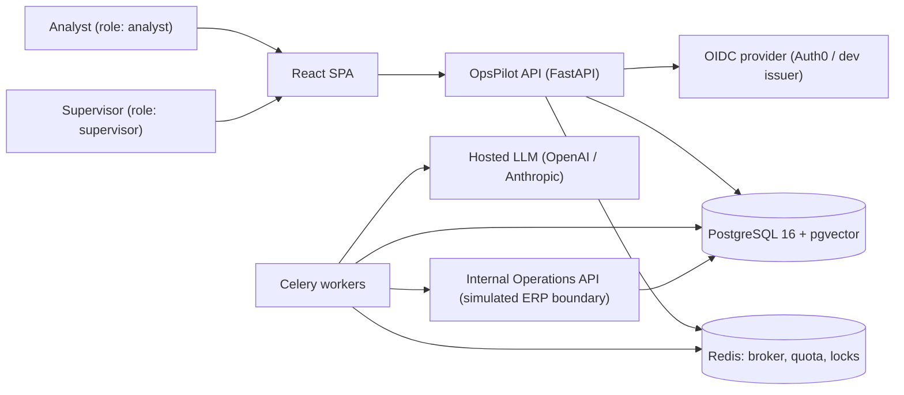
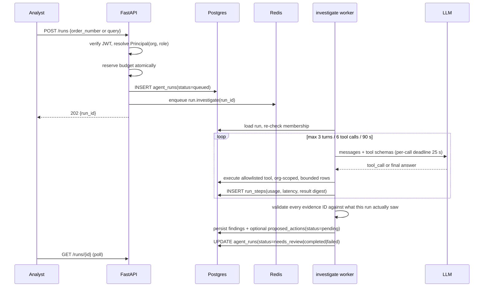

# OpsPilot — System Architecture

> Status: foundation. This document is the authoritative description of the system
> shape. If the code and this document disagree, one of them is a bug — fix it in the
> same change. See [HANDOFF.md](HANDOFF.md) for what is built and what is next.

## 1. What the system is

OpsPilot is a multi-tenant operations assistant for a small wholesale distributor.
An analyst asks *"Investigate order SO-1042. Why is it delayed, and what should we
do?"*. The system runs a **bounded** agent that reads operational facts through
three allowlisted read tools, retrieves currently-effective policy passages, and
returns a typed, evidence-linked finding set with an optional **proposed** action.
Nothing is written to the operational world until a supervisor approves the exact
payload; execution then happens in a durable worker with idempotent effects.

The engineering thesis of the project is not "an LLM answers questions". It is:

| Concern | How it is demonstrated |
| --- | --- |
| Multi-tenancy | `organization_id` on every tenant table, server-derived, never model-controlled |
| Bounded autonomy | 3 model turns / 6 read-tool calls / 90 s run budget / allowlisted typed tools |
| Grounding | Every factual claim carries an evidence ID that is validated in code |
| Human control | Immutable proposals bound to a payload hash + source version + 24 h expiry |
| Durability | Transactional outbox, at-least-once delivery, idempotent downstream effects |
| Measurability | 80 labelled cases, release gates, per-run cost/latency/token accounting |

## 2. Context



The **Internal Operations API** is ours. It is mounted in the same FastAPI process
but behind its own module boundary (`opspilot.ops`), its own service credential, and
its own tables. It is labelled *simulated ERP boundary* everywhere it is surfaced. It
exists so that idempotency, reconciliation and lost-response handling are real code
paths rather than claims.

## 3. Runtime components

| Process | Image | Responsibility | Scale unit |
| --- | --- | --- | --- |
| `caddy` | caddy:2 | TLS termination, static SPA serving, `/api` reverse proxy | 1 |
| `web` | build artifact | SPA; no secrets, no direct DB access | static |
| `api` | `opspilot-api` | HTTP, authz, validation, run enqueue, approvals, reads | 1–2 |
| `worker-investigate` | `opspilot-api` | agent runs (LLM + read tools) | 1 (concurrency 2) |
| `worker-execute` | `opspilot-api` | outbox dispatch, approved writes, reconciliation | 1 (concurrency 1) |
| `beat` | `opspilot-api` | periodic: outbox sweep, expiry, retention, reconcile | 1 |
| `postgres` | pgvector/pgvector:pg16 | business records, vectors, run state, outbox | 1 |
| `redis` | redis:7 | Celery broker/result, quota counters, locks | 1 |

API and workers ship as **one image with different entrypoints**. Same code, same
migrations, same config; only the process role differs. This removes a whole class of
"the worker is running an older contract" incidents on a single-VPS deployment.

## 4. Layering inside `apps/api`

Dependencies point downward only. A module must never import from a layer above it.

```
  api/routes         HTTP surface: request/response DTOs, status codes
  ├─ auth            principal extraction, OIDC verification, role checks
  ├─ services        use cases; the only place a transaction is opened
  │   ├─ agent       orchestrator, tool registry, provider adapter, prompts
  │   ├─ retrieval   chunking, embedding, organization-scoped vector search
  │   └─ ops         internal operations API client + idempotency
  ├─ domain          pure business rules: state machines, payload hashing, budgets
  ├─ models          SQLAlchemy ORM, tenant-scoped query helpers
  └─ core            config, logging, errors, clock, ids
```

Rules that continuing agents must keep:

1. **`domain` imports nothing from the project except `core`.** No DB, no IO, no
   framework. State transitions and payload hashing live there so they can be
   reasoned about and tested without a database.
2. **Routes never touch the ORM directly.** They resolve a `Principal`, call a
   service, and map the result to a response schema.
3. **Services own transactions.** One HTTP request or one Celery task = one unit of
   work. The outbox insert and the state change it describes share a transaction.
   The request's session commits *before* the response is sent (a function-scoped
   FastAPI dependency), so a 2xx always means the work is durable.
4. **Workers re-derive authorization.** A queued message carries IDs, never
   entitlements. `organization_id` in a message is a *claim to verify*, not a fact.

## 5. The two critical flows

### 5.1 Investigation (read-only, bounded)



Budget exhaustion, provider unavailability and limit exhaustion all produce a
**useful incomplete result**, not an error page: the run carries what it established,
what it could not, and a machine-readable `incomplete_reason`.

### 5.2 Approval to execution (the only write path)

```mermaid
sequenceDiagram
  participant S as Supervisor
  participant API as FastAPI
  participant DB as Postgres
  participant Q as Redis
  participant X as execute worker
  participant O as Operations API

  S->>API: POST /actions/{id}/approve {payload_hash, source_version}
  API->>DB: BEGIN
  API->>DB: SELECT action FOR UPDATE; assert pending and not expired
  API->>DB: assert payload_hash matches, source_version unchanged, approver is supervisor in org
  API->>DB: UPDATE proposed_actions(status=approved) + INSERT approvals
  API->>DB: INSERT outbox_events(action.approved)
  API->>DB: COMMIT
  Note over API,DB: state change and outbox event are one transaction
  X->>DB: dispatcher claims unpublished outbox rows (FOR UPDATE SKIP LOCKED)
  X->>Q: publish
  X->>DB: re-validate authz, approval, expiry, source version
  X->>O: create_followup_task(..., idempotency_key)
  alt response received
    O-->>X: 200 {task_id}; identical key returns the same task_id
    X->>DB: operation_tasks(succeeded), action(succeeded)
  else response lost or timeout
    X->>DB: action(reconciliation_required)
    Note over X,O: the reconciler looks up by idempotency key before any retry
  end
```

**Never** hold a worker open waiting for human approval. The investigation job ends
at `needs_review`; approval is a separate HTTP request that enqueues separate work.

## 6. Tenancy model

One database, one schema. Isolation is enforced at three layers, because any single
layer can be bypassed by a future mistake:

1. **Principal derivation.** `organization_id` comes from the verified membership row
   for the JWT subject. It is never read from a request body, query string, header or
   model-produced argument.
2. **Query construction.** Every tenant-owned read goes through
   `TenantScopedRepository`, which injects `organization_id = :org` into the base
   query. A raw `select(Model)` on a tenant table is a review-blocking defect.
3. **Database constraints.** Composite foreign keys `(organization_id, id)` make a
   cross-tenant row association fail in the database, not merely in Python.

Order numbers deliberately collide across organizations (`SO-1042` exists in both).
Any code path that resolves an order by human-readable number and forgets the org
filter is therefore a *visible* failure, not a latent one.

Caches (retrieval results, policy versions, principal lookups) include
`organization_id` **and** the document version in the key.

## 7. Trust boundaries and untrusted input

Untrusted: user request text, uploaded document text, shipment notes, every tool
result, and every model output.

- Model output is parsed into Pydantic schemas before it is allowed to mean anything.
- The model may only name tools in an allowlist; arguments are typed and range-checked.
- The model cannot pass `organization_id`, a user ID, a URL, SQL, or a file path.
- The model cannot invoke execution at all. It proposes; the backend persists the
  proposal; only the execute worker calls the operations API, and only after approval.
- Citation IDs in the final answer are checked against the evidence IDs actually
  returned to *that run*. Unsupported citations fail validation rather than reaching
  the UI.
- The system prompt states that document text cannot change permissions. That is
  defence in depth, not the control. The control is that no code path leads from
  model output to an entitlement.

## 8. Configuration and secrets

All configuration is environment-driven via `pydantic-settings` (`core/config.py`),
resolved once at startup into a single `Settings` object and injected. There is no
`os.environ` access anywhere else. Secrets never reach the browser; the SPA receives
only public OIDC configuration.

`APP_ENV` is one of `development | test | staging | production`. Several behaviours
are hard-gated on it — most importantly the local dev token issuer, which refuses to
load unless `APP_ENV` is `development` or `test`.

**Business date.** "Overdue" and "effective" are evaluated on one business date,
`core.clock.business_date(settings)`: today in UTC, or `OPERATIONS_AS_OF` when the
dataset is frozen (the synthetic seed is 2026-09-12). The inbox, order detail, the
agent's prompt and tools, and the knowledge screen all use it, so the analyst and the
agent never look at different days. Expiry, retention and budget windows always use
real time.

## 9. Observability

Structured JSON logs (`structlog`) carrying a request/run correlation ID on every
line; operational metadata only — never full prompts, never document bodies. Run-level
accounting (model, prompt version, tokens in/out, retries, per-tool latency, cost
estimate, incomplete reason) is written to `agent_runs` / `run_steps`, which is what
`/metrics/summary` and the run-history screen read. That database-backed dashboard
replaces a hosted monitoring stack at this scale, deliberately. The evaluation
harness (`evals/harness`, `pnpm eval`) measures the same records in an isolated
database per run.

## 10. Deployment shape

One 2 vCPU / 4 GB VPS, Docker Compose, Caddy for automatic HTTPS. Only 80/443 are
exposed; Postgres and Redis sit on an internal network with no published ports.
Images are built off-server and pulled by tag; rollback is `docker compose up -d` with
the previous tag, which is why migrations must stay backward compatible for one
release (expand, migrate, contract).

## 11. Explicit non-goals for v1

Arbitrary SQL, autonomous customer messaging, refunds or cancellations, browser
automation, OCR or scanned PDFs, real ERP integration, multi-agent coordination,
fine-tuning, Kubernetes, streaming responses, and a general-purpose agent framework.
Polling is the transport for run status. Retrieval is exact vector search until a
measured lexical miss justifies otherwise.
