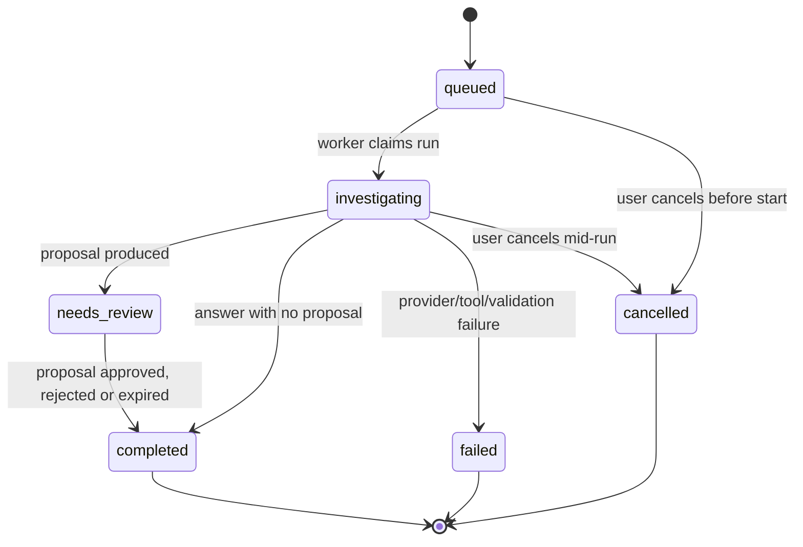
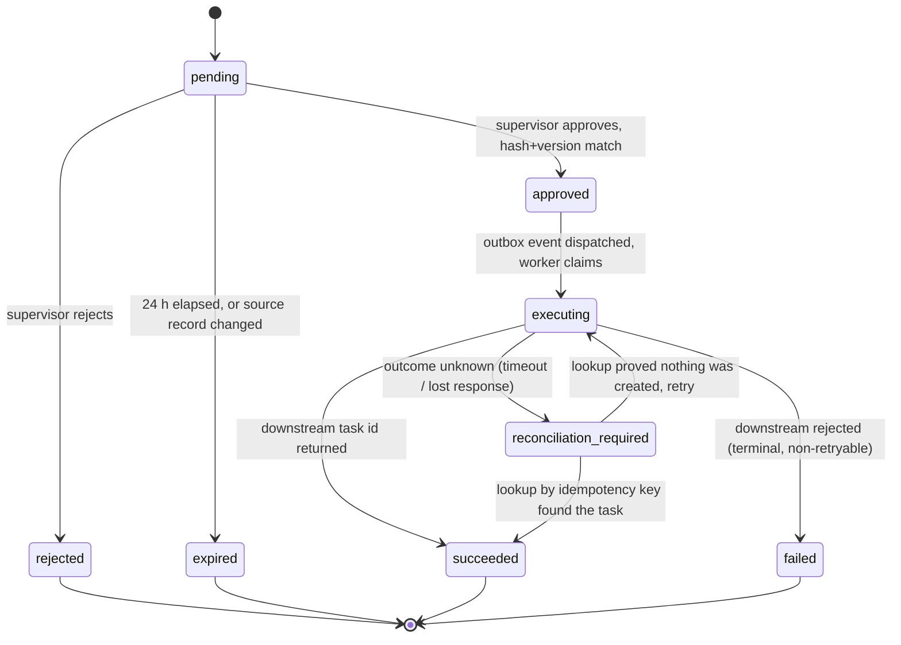

# OpsPilot — State Machines and Invariants

Both machines live in `apps/api/src/opspilot/domain/state.py` as pure functions over
enums. No service may set a status by assignment; it calls the transition function,
which raises `IllegalTransition` on an undefined edge. This is how an illegal state
change becomes a loud failure instead of a data problem discovered weeks later.

## 1. Run lifecycle (`agent_runs.status`)



Invariants:

- `queued` is written in the same transaction as the request; the enqueue happens
  **after** commit (an `after_commit` hook), so a rolled-back request never leaves a
  message pointing at a row that does not exist.
- A run may only be claimed once: the worker transitions `queued -> investigating`
  with a conditional `UPDATE ... WHERE status = 'queued'` and stops if zero rows are
  affected. Duplicate delivery of `run.investigate` therefore cannot double-charge.
- `failed` carries `error_code` from `core/errors.py`; `completed` and `needs_review`
  may carry `incomplete_reason` (`budget_exhausted`, `turn_limit`, `tool_limit`,
  `deadline`, `provider_unavailable`, `insufficient_evidence`). An incomplete run is
  still a *successful HTTP outcome* — it shows what was established and what was not.
- The worker commits its claim before provider work. Cancellation of an active run
  sets `cancel_requested_at`; it remains investigating until the worker settles.
  Checks between provider calls and tools stop further work; an in-flight call may
  finish or time out. Finalization refreshes and locks the run and membership so a
  winning cancellation or revocation suppresses results and proposals.
- A scheduled sweep closes claims older than the run deadline plus 120 seconds as
  failed (`worker.lost`), or cancelled if requested. Unknown usage keeps its budget
  reservation, and late worker completion cannot resurrect the run.

Budgets, all counted including retries:

| Bound | Value | Enforced in |
| --- | --- | --- |
| Model turns | 3 | orchestrator loop |
| Read-tool calls | 6 | tool dispatcher |
| Per-provider-call deadline | 25 s | provider adapter |
| Whole-run deadline | 90 s | orchestrator, checked before each turn |
| Aggregate input tokens | 20 000 | budget reservation |
| Aggregate output tokens | 3 000 | budget reservation |
| Per-user daily spend | configurable | Redis counter, atomic reserve |
| Application monthly spend | USD 15 | Redis counter, fail closed |

## 2. Proposed action lifecycle (`proposed_actions.status`)

Deliberately **separate** from the run lifecycle: a run finishes while its proposal is
still pending, so no worker is held open across human review.



### Approval invariants (each one is a release gate)

1. The approver's membership and `supervisor` role are resolved **server-side at
   decision time**. A role revoked after the proposal was created must block approval.
2. Approval binds to `(organization_id, payload_hash, source_record_version)`. The
   client must echo the `payload_hash` it displayed; a mismatch is `409 Conflict`, not
   a silent re-read. This is what prevents "approve what you saw" drift.
3. Any edit to the payload, or any change to the source order's `record_version`,
   invalidates the proposal. There is no "amend and approve" path — a new proposal is
   created and must be approved on its own.
4. Expiry is 24 hours from creation, evaluated at decision time *and* again in the
   execute worker. A proposal approved at 23 h 59 m that reaches the worker at 24 h
   01 m still executes: expiry binds the decision, not the delivery.
5. The status change and the outbox insert are one transaction. If the process dies
   immediately after commit, the sweep publishes the event; if it dies before, nothing
   happened at all.
6. The execute worker re-validates everything from scratch: membership still active,
   role still supervisor, action still approved, not expired at decision time, source
   version unchanged. It trusts nothing in the message except the IDs.
7. The operations API enforces `idempotency_key UNIQUE` and returns the *same*
   `task_id` for a duplicate. A network timeout is never interpreted as "no effect".

### Reconciliation rule

On any uncertain outcome the worker writes `reconciliation_required` **before**
retrying. The reconciler calls `GET /ops/tasks?idempotency_key=...`:

- found, and it belongs to this action: mark `succeeded` with the returned task id;
- definitively not found: return to `executing` and retry with the same key;
- unavailable: leave `reconciliation_required`, surface it in the UI, alert. Never
  retry a write whose outcome is unknown and whose key lookup failed.

This is **at-least-once delivery with idempotent effects**. It is not exactly-once
delivery, and it must never be described as such.

## 3. Document lifecycle (`documents.status`)

```
pending -> indexing -> active
              |
              +-> failed (retryable; content_hash makes re-index safe)
active -> deleted (chunks removed in the same transaction)
```

Re-uploading identical content (same `content_hash`) is a no-op that returns the
existing version. Re-uploading changed content creates version N+1, sets
`effective_from`, closes the previous version's `effective_to`, and re-indexes.

## 4. Error taxonomy

`core/errors.py` defines one exception hierarchy mapped to HTTP status and to an
`error_code` string that is stable enough to be asserted in evaluation cases.

| Class | HTTP | `error_code` | Meaning |
| --- | --- | --- | --- |
| `NotAuthenticated` | 401 | `auth.unauthenticated` | missing/invalid token |
| `NotAuthorized` | 403 | `auth.forbidden` | authenticated, wrong org or role |
| `ResourceNotFound` | 404 | `resource.not_found` | includes cross-tenant reads |
| `ConflictError` | 409 | `state.conflict` | hash/version mismatch, illegal transition |
| `ValidationError` | 422 | `request.invalid` | schema or range violation |
| `QuotaExceeded` | 429 | `budget.exhausted` | user or application budget |
| `ProviderUnavailable` | 503 | `provider.unavailable` | model provider failure |
| `DownstreamUncertain` | — | `ops.uncertain` | internal only; drives reconciliation |

A cross-tenant read returns **404, not 403**. Confirming that an ID exists in another
organization is itself a disclosure.
