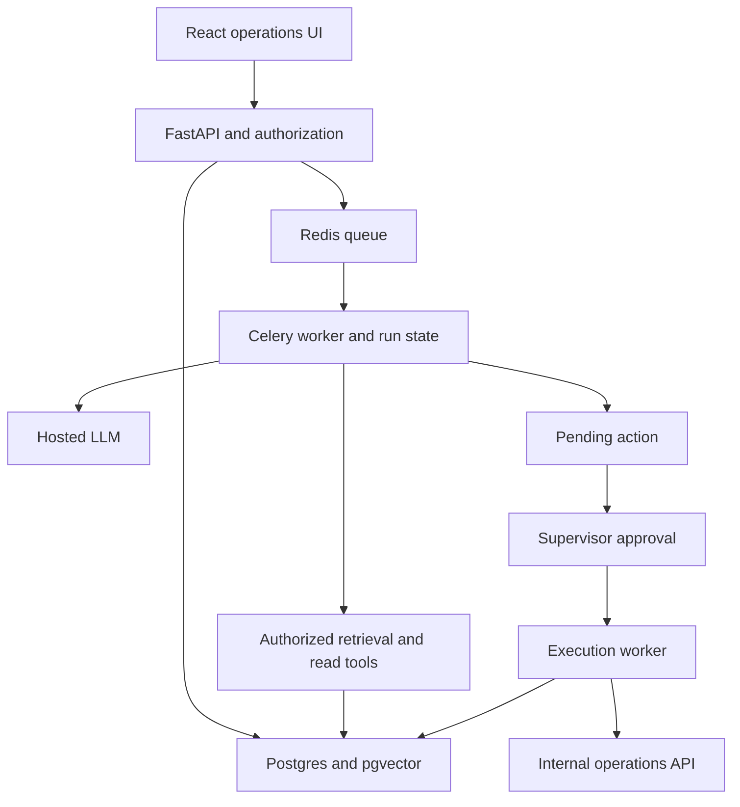

# OpsPilot — Enterprise AI Operations Agent | Solo Build Plan

## Project decision

Build **OpsPilot**, an operations assistant for a small wholesale distributor. It investigates delayed orders and shipment exceptions, retrieves relevant operating policies, proposes a resolution, and creates an internal follow-up task after a supervisor approves it.

**Planning assumption:** one developer, 10–12 hours per week, approximately 10 weeks (100–120 hours). Local development first; deploy a small pilot once the workflow is reliable. The estimate includes a buffer, not a guarantee.

**Budget target:** USD 5–15 per month during local development; approximately USD 20–35 per month for a small hosted pilot. No GPU rental, model training, paid ERP, or paid vector database is needed. Detailed assumptions are in the budget section below.

## What you will demonstrate

- A bounded agent that chooses tools based on a request, combines retrieved policy with live operational facts, and returns evidence-backed conclusions.
- Multi-tenant authorization, approval-controlled writes, durable background work, recovery, and an audit trail.
- Measured quality, latency, and cost; an actual deployed pilot with feedback.
- A portfolio system built with enterprise engineering practices. Describe it as production experience only once people use the deployed workflow; synthetic data and mock integrations must remain clearly labeled.

## The first supported workflow

**User request:** “Investigate order SO-1042. Why is it delayed, and what should we do?”

1. Resolve the order inside the authenticated organization.
2. Retrieve order lines, shipment events, and existing exception tasks.
3. Search that organization's current delayed-shipment policy.
4. Produce a concise explanation with order/event references and policy citations.
5. Propose a task, such as “Contact the carrier for an ETA,” with its owner and due date.
6. Show the exact action payload to a supervisor.
7. After approval, execute the task creation through an internal operations API and show the resulting task ID.

**Additional supported requests:** “Which orders are overdue today?” and “Explain this shipment exception using our policy.”

**MVP boundaries:** English; typed requests; synthetic operational data; Markdown and plain-text policy uploads; three tools for reading plus one approved write. No arbitrary SQL execution, autonomous customer messaging, refunds, order cancellation, browser automation, OCR, or ERP integration in version 1.

## Product screens

- **Operations inbox:** overdue orders and exception cases with filters.
- **Case workspace:** request, findings, citations, tool activity, and proposed action.
- **Approval inbox:** exact proposed changes, approve/reject, expiration, and execution status.
- **Knowledge:** document upload, version, indexing status, and deletion.
- **Run history:** status, elapsed time, token cost, errors, and user feedback.

## Architecture

Use a modular backend with a separate worker process. A small state machine and native model tool calling are sufficient.

## Implementation choices

| Component | Choice | Reason |
| --- | --- | --- |
| UI | React, TypeScript, Vite | Familiar stack; static build is cheap to serve. |
| Backend | FastAPI, Pydantic, SQLAlchemy, Alembic | Typed tool inputs and transactional application logic. |
| Storage and search | PostgreSQL with pgvector | One database for business records, retrieval, and run state. |
| Background work | Celery and Redis | Use your existing experience; persist business state in Postgres. |
| Model | GPT-4.1 mini as initial benchmark candidate; direct provider SDK behind a small adapter | Start with one model; change only when evaluation supports it. |
| Embeddings | text-embedding-3-small | Low indexing cost; record model and dimension with each index version. |
| Identity | Existing Auth0 familiarity; verify plan limits before deployment | Use established OIDC login; backend validates issuer, audience, signature, and expiration. |
| Deployment | Docker Compose on one small Linux VPS; Caddy for HTTPS | Manageable solo deployment with few services. |
| Visibility | Structured JSON logs and database-backed run dashboard | Track failures and costs without hosting a large monitoring stack. |

pgvector supports vector search inside Postgres. Start with exact search for this small dataset and add indexes only after measuring. [Official pgvector documentation](https://github.com/pgvector/pgvector)

## Budget and hardware

Your existing 16 GB laptop is sufficient for this development scope; inference runs through an API. Limit Docker resources and worker concurrency initially. GPU usage is unnecessary.

| Item | Planning allowance | Assumptions |
| --- | --- | --- |
| Local infrastructure | USD 0 incremental hosting | Existing computer; electricity and internet excluded. |
| LLM development and evaluation | USD 5–15/month | Small datasets, capped runs, cached fixtures for routine tests. |
| Hosted VPS | USD 8–12/month allowance | Approximately 2 vCPU and 4 GB RAM; inspect actual regional checkout price. |
| Backup storage | USD 1–3/month allowance | Small encrypted off-server backups; verify provider minimums. |
| Domain | Optional USD 10–20/year allowance | Reuse an existing domain if available. |
| Hosted pilot total | Target USD 20–35/month | Low traffic; tax, exchange rates, and provider limits can change the total. |

These are planning allowances, not vendor quotes. As checked on September 11, 2026, Hetzner advertises a CX23 with 2 vCPU and 4 GB RAM at EUR 5.99/month; regional pricing and checkout extras need checking before purchase. [Hetzner official site](https://www.hetzner.com/)

**Illustrative inference estimate:** at USD 0.40 per million input tokens and USD 1.60 per million output tokens, a completed investigation totaling 12,000 input and 2,000 output tokens across all its model calls costs about USD 0.008. One thousand such runs cost about USD 8 before retries and additional evaluation. This is a workload assumption, not a measured result. [GPT-4.1 mini model pricing](https://developers.openai.com/api/docs/models/gpt-4.1-mini)

At USD 0.02 per million embedding tokens, indexing 500,000 tokens costs roughly USD 0.01. Re-indexing and query embeddings add usage. [Embedding model pricing](https://developers.openai.com/api/docs/models/text-embedding-3-small)

**Cost controls:** configure a USD 15 monthly application AI budget, a USD 2 daily limit, maximum three model turns per investigation, a 20,000 input-token aggregate ceiling, and a 3,000 output-token aggregate ceiling. Count retries toward limits. Reserve estimated spend atomically before calls, reconcile actual usage afterward, and fail closed when the reserve is exhausted. Public access must require login and have per-user quotas.

Build locally to avoid ongoing hosting fees until week 8. Use mocked provider responses for ordinary CI and reserve paid calls for evaluation. No free API credits are assumed. A ChatGPT subscription should not be counted as API funding.

## Completion standard

A working chat window is the start. Completion means a deployed pilot, reproducible evaluation results, passing authorization and duplicate-execution checks, a tested restore procedure, and documented limitations. The child pages below provide the implementation contract, weekly checklist, release gates, and reusable AI prompts.

[01 — Technical Contract and Data](OpsPilot%20%E2%80%94%20Enterprise%20AI%20Operations%20Agent%20Solo%20Bui/01%20%E2%80%94%20Technical%20Contract%20and%20Data%203d88a2d10e4481dd8da6d72b3479909f.md)

[02 — Weekly Build Checklist](OpsPilot%20%E2%80%94%20Enterprise%20AI%20Operations%20Agent%20Solo%20Bui/02%20%E2%80%94%20Weekly%20Build%20Checklist%203d88a2d10e4481c6a615dbe1760bb36f.md)

[03 — Evaluation, Release Gates and Pilot](OpsPilot%20%E2%80%94%20Enterprise%20AI%20Operations%20Agent%20Solo%20Bui/03%20%E2%80%94%20Evaluation,%20Release%20Gates%20and%20Pilot%203d88a2d10e44819f88e9e0e250d49224.md)

[04 — AI Prompt Library](OpsPilot%20%E2%80%94%20Enterprise%20AI%20Operations%20Agent%20Solo%20Bui/04%20%E2%80%94%20AI%20Prompt%20Library%203d88a2d10e4481c18eabcabd6111dab4.md)